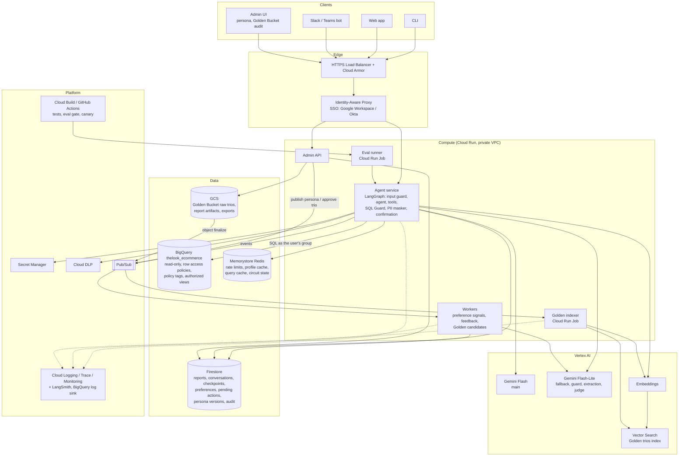
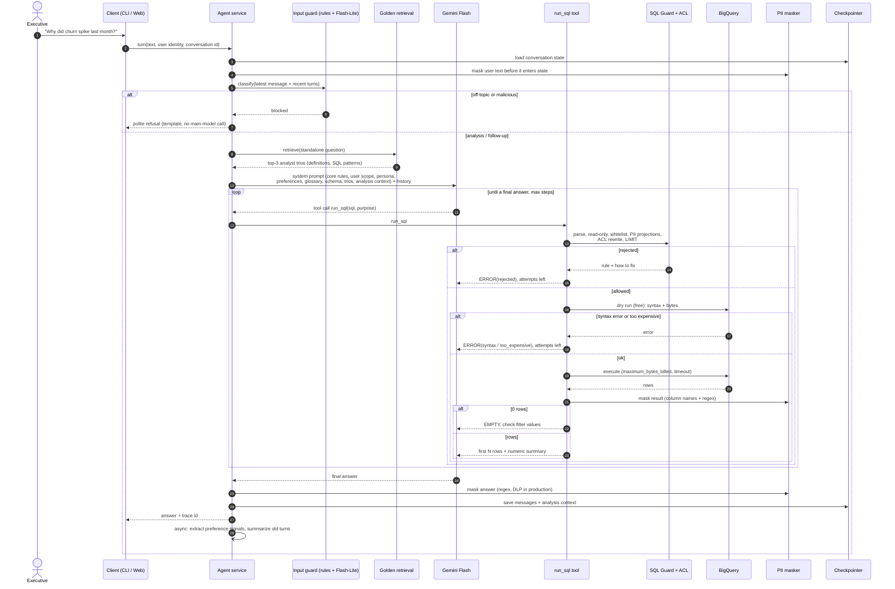
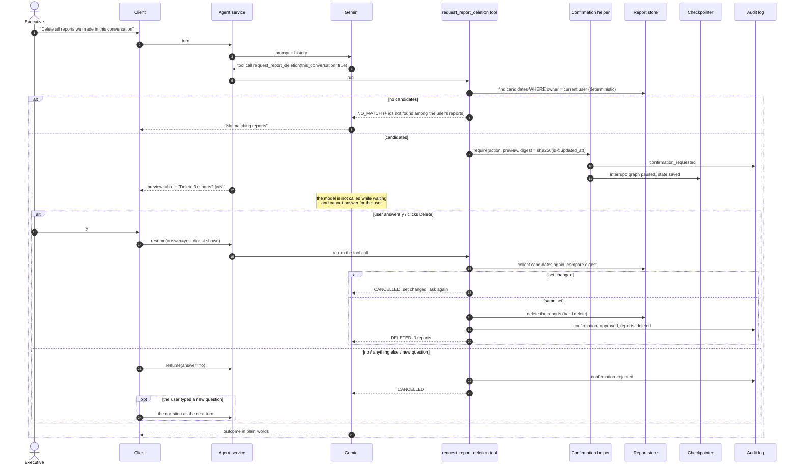
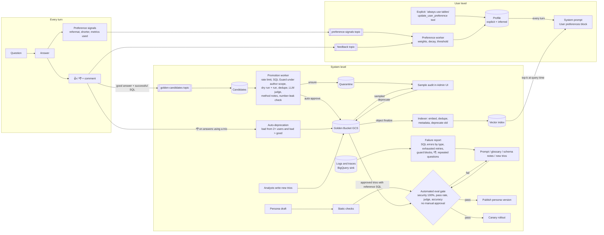
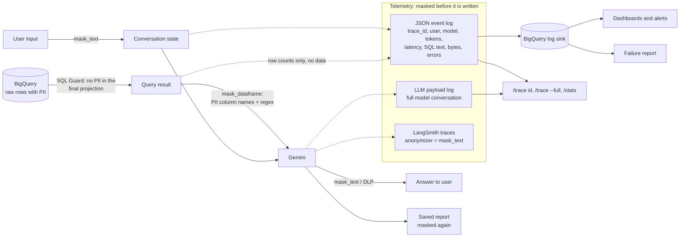
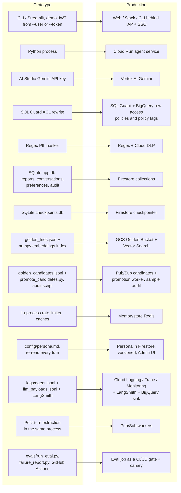

# Architecture

This document is the high-level design (HLD) of the Retail Analytics Agent: the production
architecture, the main flows as sequence diagrams, where data lives and how the components talk
to each other. How each requirement is solved, and what the prototype implements, is in
[technical_design.md](technical_design.md). Assumptions behind the numbers are in
[assumptions.md](assumptions.md).

Contents:

1. [Production architecture](#1-production-architecture)
2. [Services: what, why, alternatives](#2-services-what-why-alternatives)
3. [Answering a question](#3-answering-a-question)
4. [Deleting reports with confirmation](#4-deleting-reports-with-confirmation)
5. [Learning loop](#5-learning-loop)
6. [Observability and the path of PII](#6-observability-and-the-path-of-pii)
7. [Prototype vs production](#7-prototype-vs-production)
8. [Data storage](#8-data-storage)
9. [Component interaction](#9-component-interaction)

Sizing (D19, confirmed by OpsFleet): tens to a few hundred executives, about 100 active managers
a day asking about 10 questions each, only a few active at once. Targets: 10-30 s for a simple
question, 1-2 minutes for a long report. What that means for the design:

| Quantity | Estimate | How it was derived |
|---|---|---|
| Questions | about 1,000 a day; about 2 a minute on average in an 8-hour day, about 6 a minute at a 3x peak | 100 managers x 10 questions |
| Busy sessions at the peak | about 3 for simple questions (30 s), up to about 12 if all were long reports (2 min) | 6 questions a minute x time per question |
| LLM calls | at most 5 per question (input guard, up to 3 agent steps, one post-turn call), so at most 5,000 a day and about 30 a minute at the peak | the per-turn budget, see technical design R5 |
| Tokens per question | median 11k in / 0.35k out, p90 21k / 1.2k | prototype eval run of 2026-11-23 |
| LLM cost | about $10 a day at the median, $21 a day at the p90 (Flash prices, $0.75 / $3.75 per 1M tokens; auxiliary calls on Flash-Lite cost less) | 1,000 questions x tokens |
| BigQuery | about 10 MB per query on `thelook_ecommerce`, under 0.1 TB a day; capped at 2 GB per query and 10 GB per question | prototype logs |

So the load is small: one Cloud Run service with a minimum of one instance covers the peak, and
the binding constraint is the LLM quota, not compute. On a free AI Studio key (Flash about 5
requests a minute and 20 a day, Flash-Lite about 15 and 500) the prototype answers a handful of
questions a day on Flash, about 6 since each uses up to 3 Flash calls, and then switches to
Flash-Lite automatically (D18); production uses Vertex AI with a paid quota. Availability target:
99.5%.

---

## 1. Production architecture

How to read it:

- **One stateless agent service.** All conversation state (messages, interrupts, analysis
  context) lives in a checkpointer backed by Firestore, so any Cloud Run instance can serve any
  turn and a pending confirmation survives a redeploy.
- **The synchronous path is short:** client, IAP, agent service, then Vertex AI, BigQuery and
  Firestore. Everything that is not needed to answer the user (extracting preference signals,
  feedback, indexing new trios, eval) is asynchronous through Pub/Sub.
- **Safety is enforced twice:** in the agent (SQL Guard, ACL rewrite, PII masking, input guard)
  and in the data platform (BigQuery row access policies, policy tags on PII columns, authorized
  views). A bug in the agent cannot leak data the user's BigQuery identity cannot read.

---

## 2. Services: what, why, alternatives

| Building block | Service | Why | Alternatives and why not |
|---|---|---|---|
| Identity | Identity-Aware Proxy + SSO (Google Workspace or Okta via SAML/OIDC) | Executives log in with the corporate account; the frontend passes a JWT signed by the identity provider whose claims carry the role and brands (from directory groups), and the agent verifies it against the IdP's JWKS. No passwords in the app | App-level OAuth: more code and more to get wrong. API keys per user: no SSO, no offboarding |
| Edge | HTTPS Load Balancer + Cloud Armor | TLS, WAF rules, rate limiting per client | API Gateway: fine for pure APIs, weaker for the web app and websockets/streaming |
| Agent compute | Cloud Run (min 1 instance, autoscale, concurrency ~10) | Stateless container, one instance covers the peak of about 3-12 busy sessions and it scales out if usage grows, streaming responses, pay per use, VPC connector | GKE: operational overhead not justified at a few hundred users. Cloud Functions: request time limits and cold starts for long multi-step turns |
| Background jobs | Cloud Run Jobs / Cloud Run services subscribed to Pub/Sub | Same container image and code as the agent, retries and dead-letter topics from Pub/Sub | Cloud Composer: too heavy for a handful of event handlers |
| LLM | Gemini Flash (main) and Flash-Lite (fallback, guard, extraction, summaries, judge) on Vertex AI | Required by the client; Vertex gives enterprise quotas, SLA, data residency, VPC-SC, no training on our data. Flash-Lite for cheap high-volume calls keeps the main model's quota for reasoning | AI Studio API (used in the prototype): free tier, no SLA, low quotas. Other providers: possible behind the same interface, but the client tests with Gemini |
| Embeddings and retrieval | Vertex AI embeddings + Vertex AI Vector Search (hybrid: dense + sparse/keyword) | Managed ANN index with metadata filters (status, schema version, tables), hybrid search for metric names and SQL terms | BigQuery Vector Search: good for batch, higher latency per query. AlloyDB pgvector: one more database to run. At a few thousand trios any of them works; Vector Search keeps it serverless |
| Analytical data | BigQuery, read-only | The dataset is already there; row access policies by brand, policy tags on PII columns, authorized views, `maximum_bytes_billed`, dry runs, job labels for cost attribution | Copying data to another store: duplication and drift |
| Operational store | Firestore (Native mode) | Serverless, document model fits reports, conversations, checkpoints and preferences; TTL policies for retention; per-document security; no capacity planning | Cloud SQL Postgres: a good choice if reporting over this data in SQL is needed, but one more instance to size, patch and fail over |
| Cache and limits | Memorystore for Redis | Shared rate limiter per model quota across instances, profile cache, query result cache, circuit breaker state | In-process caches (prototype): each instance would have its own limits and caches |
| Files | Cloud Storage | Golden Bucket raw trios (versioned objects), exported reports, future charts; object events start indexing | Storing trios only in the vector DB: no raw history, no easy review |
| Events | Pub/Sub | Decouples the user's turn from learning and indexing; retries, dead letters, ordering keys per user | Cloud Tasks: point-to-point only. Calling workers synchronously: slower turns, failures leak into the user path |
| PII | Cloud DLP | Inspection of free text (answers, saved reports) for PII types regexes miss; de-identification templates | Presidio self-hosted: works, but more to operate |
| Secrets | Secret Manager | API keys (LangSmith, email provider), no secrets in images or env files | Env vars from CI: leak into logs and build history |
| Observability | Cloud Logging, Trace, Monitoring, Error Reporting + LangSmith; log sink to BigQuery | Structured logs with `trace_id`, OpenTelemetry spans, alerting; LangSmith for LLM-level traces, datasets and prompt comparison; BigQuery sink for the failure analysis and dashboards | Langfuse self-hosted: a good alternative if traces must stay in our project; Arize Phoenix similar |
| Persona and prompt versions | Firestore documents + Admin UI (optionally LangSmith prompt hub) | Versioned, reviewable, instant publish without redeploy, rollback | Prompts in code: needs a developer and a deploy |
| CI/CD | GitHub Actions (tests, lint) + Cloud Build (image) + Cloud Deploy (canary) | The eval gate runs before traffic shifts; canary 10% for prompt or model changes | Manual deploys |

---

## 3. Answering a question

Notes:

- **Self-correction is bounded:** after `MAX_SQL_FAILURES` (3) failed attempts in a turn the tool
  returns `STOP` and the model must explain what went wrong. Each turn also has a BigQuery byte
  budget and a step limit, so a confused model cannot loop or run up costs.
- **Dry runs are free** and catch syntax errors, unknown columns and expensive scans before any
  bytes are billed.
- **Follow-ups** ("and only for Jeans?") work because the analysis context (last SQL, period,
  filters, result summary) is in the prompt. The refined SQL goes through the guard and ACL again.
- Multi-step questions ("why", "compare", "report") follow the core prompt rule: state 2 to 4
  hypotheses, run one query per hypothesis, then synthesize with numbers.

---

## 4. Deleting reports with confirmation

What makes it strict:

- **The model can only ask.** The answer to the interrupt comes from the client, never from the
  model. A "yes" typed into the chat history is not a confirmation.
- **Exactly what was shown is deleted.** The digest of the previewed set travels with the answer;
  if a report was added or changed in between, nothing is deleted and the user is asked again.
- **Only the user's own reports**, enforced in the store's queries, not in the prompt. Other
  users' reports and missing ids look the same ("not found"), so their existence is not revealed.
- **UX is not broken:** "no", any other reply, or a new question cancels. A new question is then
  answered right away without retyping.
- The same helper guards every tool with side effects: `export_report` today, e-mail or Slack
  posting tomorrow. A tool registered with `requires_confirmation` that performs its effect
  without an approved confirmation raises an error.

---

## 5. Learning loop

- **User level:** explicit preferences apply at once; inferred ones need consistent signals from
  at least two different turns and a confidence above 0.7, and old signals decay (half-life 30
  days). The profile goes into every prompt; the current message overrides it, and it can never
  override safety rules.
- **System level:** good interactions become candidates and an automatic pipeline promotes them
  into the Golden Bucket (no human approval in the loop: it would not scale); people audit only
  what the pipeline was unsure about and a sample of what it approved. Trios whose answers collect
  negative feedback are deprecated automatically. Failures are clustered into a report that drives
  prompt, glossary and trio changes. Every change passes the automated eval gate first; approved
  trios double as eval cases with reference SQL.

---

## 6. Observability and the path of PII

Where PII exists, and where it does not:

| Place | PII? | Why |
|---|---|---|
| BigQuery `users` table | Yes | Source data. In production PII columns carry policy tags; the agent's service account has no fine-grained reader role on them, so even `SELECT email` fails at BigQuery |
| SQL text | May contain a literal (`WHERE email = '...'`) | PII may be used in filters and joins (D6). The SQL text is masked before it is logged or traced |
| Query results passed to the model | No | The final projection cannot contain PII columns (SQL Guard), and results are masked by column name and by regex before the model sees them |
| Model answer, saved reports, exports | No | Masked at the agent node (so no checkpoint has unmasked text), again at the output guard; DLP in production |
| User input | Masked | If a user pastes an e-mail, it is masked before it enters the conversation state, the logs or LangSmith |
| Logs, payload log, LangSmith | No | Every string field goes through the masker; LangSmith uses `mask_text` as its anonymizer |

Agent-level metrics (computed by `/stats` in the prototype, Cloud Monitoring in production):
turn success rate and errors by kind; SQL self-correction rate and success of corrections;
latency p50/p95/p99 per turn and per component; tokens and cost per turn, user and day; BigQuery
bytes; guardrail events (input guard blocks by category, SQL Guard rejections by rule, PII
masked, ACL-filtered queries); confirmations requested, approved, rejected and stale; feedback
👍/👎; retries, fallbacks and cooldowns per model. Alerts: error rate above 5% over 15 minutes,
fallback share above 50%, cost per day above budget, any BigQuery access-denied spike.

---

## 7. Prototype vs production

The code is shaped for this move: storage, checkpointer, embedder, model factory and BigQuery
runner are injected objects, so production replaces implementations without touching the
graph, the tools or the prompt.

---

## 8. Data storage

| Data | Prototype | Production | Who can access | Retention | PII |
|---|---|---|---|---|---|
| Transaction data (`orders`, `order_items`, `products`, `users`) | BigQuery public dataset | BigQuery, read-only; row access policies by brand; policy tags on PII columns | Agent service account, queries run with the user's brand scope | Owned by the data platform | Yes in `users` (names, e-mail, address, postal code, coordinates); never leaves BigQuery unmasked |
| Conversation history and state (messages, tool calls, analysis context, pending confirmations) | `data/checkpoints.db` (LangGraph SqliteSaver) | Firestore checkpointer, encrypted at rest | The owner (checked on resume); on-call via break-glass | 90 days after the last activity (purged at start in the prototype, Firestore TTL in production) | No (masked before saving) |
| Conversation index (owner, title, turns) | `data/app.db` `conversations` | Firestore `conversations` | Owner | Same as history | No |
| Saved reports | `data/app.db` `reports` (question, answer in Markdown, source SQL, entities) | Firestore `reports` + GCS for large artifacts | Owner only (no sharing, D13) | Until the owner deletes them (hard delete, no recovery window) | No (masked on save) |
| Exports | `exports/<id>.md` | GCS bucket with signed URLs | Owner | 30 days | No |
| Audit log (confirmations, deletions, exports) | `data/app.db` `audit_log` | Firestore `audit` + Cloud Audit Logs, exported to BigQuery | Security, on-call (read-only) | 1 year (purged on open in the prototype, Firestore TTL in production) | No |
| User preferences and signals | `data/app.db` `user_preferences`, `preference_signals` | Firestore + Redis cache | Owner (view, change, forget), the agent | Signals decay; forgotten on request or after 12 months inactive | No (whitelisted values only) |
| Golden Bucket trios | `data/golden_trios.json` (15 trios) | GCS (versioned objects) | Analysts write, agent reads | Versioned; deprecated trios kept for audit | No |
| Golden index | `data/golden_index.npz` (rebuilt when trios change) | Vertex AI Vector Search | Agent, indexer | Rebuilt from GCS | No |
| Golden candidates | `data/golden_candidates.jsonl` | Firestore `golden_candidates` | Promotion worker, auditors | 90 days from creation (approved ones live on as trios with method notes only) | No (masked) |
| Persona | `config/persona_draft.md` -> `config/persona.md`, versions in `config/persona_versions/` | Firestore `persona_versions` | Content owners edit, agent reads | All versions kept | No |
| Glossary, PII policy, users and access groups | `config/*.yaml` | Firestore / directory groups | Admins | Versioned | No |
| Schema cache | `data/schema_cache.json` (7 days) | Redis | Agent | 7 days | No (column names only) |
| Query result cache | In-memory, 10 min, 100 entries | Redis, keyed by rewritten SQL (so per access scope) | Agent | 10 min | No (masked results) |
| Event log | `logs/agent.jsonl` | Cloud Logging, sink to BigQuery | On-call, analysts of agent quality | 90 days (they hold masked messages and SQL) | No (masked) |
| Full model conversations | `logs/llm_payloads.jsonl` (`LOG_LLM_PAYLOADS`) | Sampled into Cloud Logging / LangSmith | On-call | 90 days in the prototype; 14 days sampled in production | No (masked) |
| LLM traces | LangSmith (optional) | LangSmith (or self-hosted Langfuse) | On-call, prompt engineers | 14 to 30 days | No (anonymizer) |
| Eval results | `evals/results/<ts>.json` | GCS + BigQuery table per run | Engineering | Kept for comparing versions | No |
| Secrets | `.env` (not committed) | Secret Manager | Service accounts | Rotated | n/a |

---

## 9. Component interaction

### Synchronous calls

| From | To | Protocol | What |
|---|---|---|---|
| Client | Agent service | HTTPS behind IAP; server-sent events for streaming stages | `POST /conversations/{id}/turns {text}` returns stages (`Checking request…`, `Querying BigQuery…`, `Writing answer…`) and the final answer, or a pending confirmation. `POST /conversations/{id}/confirmations {interrupt_id, answer, digest}` resumes |
| Agent | Vertex AI Gemini | gRPC/REST (`generateContent`) | Chat with tools; per-call timeout 60 s, retries only on 429 per-minute and 5xx within a 30 s budget, then fallback |
| Agent | Vertex AI embeddings + Vector Search | REST | Embed the standalone question, `findNeighbors` with filter `status = approved` |
| Agent | BigQuery | REST (jobs.query) | Dry run, then query with `maximum_bytes_billed`, labels `app=retail_agent,user=...`, timeout 60 s |
| Agent | Firestore | gRPC | Checkpoints, reports, preferences, audit (transactions for delete + audit) |
| Agent | Redis | RESP | Rate limiter tokens per model, profile and query caches, circuit state |
| Agent | Cloud DLP | REST | `content.inspect` / `deidentify` on answers and reports |
| Admin UI | Admin API | HTTPS behind IAP | Persona drafts, preview, publish; Golden Bucket audit (quarantine, sampled trios) |

### Asynchronous events (Pub/Sub)

All messages are JSON with `event_id`, `ts`, `trace_id`, `user_id` (internal id, not PII) and a
`schema_version`. Subscriptions are push to Cloud Run with retries and a dead-letter topic;
handlers are idempotent by `event_id`.

| Topic | Producer | Consumer | Payload |
|---|---|---|---|
| `feedback` | Agent (on 👍/👎) | Preference worker; candidate builder; metrics | `{"trace_id", "conversation_id", "user_id", "rating": "good" \| "bad", "comment"}` |
| `preference-signals` | Agent, after the turn | Preference worker | `{"user_id", "signals": [{"key": "detail_level", "value": "brief", "kind": "reformat_request", "weight": 1.0, "evidence": "asked for shorter, previous answer 412 words"}]}` |
| `golden-candidates` | Candidate builder (good feedback + successful SQL) | Candidate store, promotion worker | `{"candidate_id", "question", "sql": [...], "answer_summary", "user_role", "trace_id"}` (masked) |
| `trio-ingested` | GCS object finalize (approved or analyst-written trio) | Indexer job | `{"bucket", "object", "generation"}`; the indexer embeds, deduplicates (cosine > 0.95 with an existing trio goes back to review), writes metadata (tables, metrics, schema version, author, status) |
| `persona-published` | Admin API | Agent instances (invalidate cache) | `{"version", "hash", "published_by"}` |
| `eval-completed` | Eval job | CI/CD, dashboards | `{"run_id", "commit", "models", "summary": {"passed", "total", "security_pass_rate", "judge_mean", "accuracy"}}` |

The user's turn never waits for a Pub/Sub consumer: if the workers are down, answers continue
and learning catches up when they recover.
